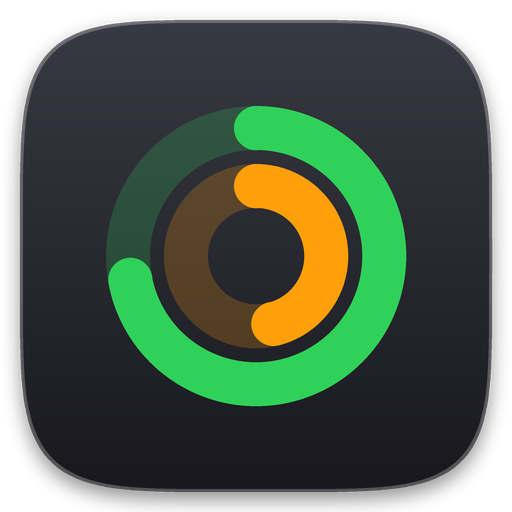
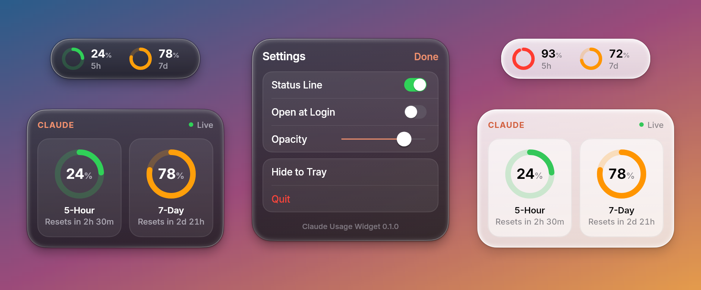
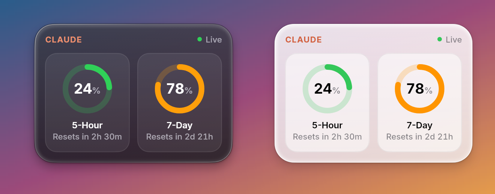
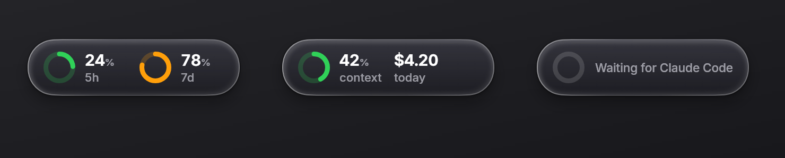

<div align="center">



# Claude Usage Widget

**See your Claude Code limits at a glance, without typing `/usage`.**

A small always-on-top desktop widget with activity-style rings for your
5-hour and 7-day limits. Local only: no network calls, no login token.

[](https://github.com/jihanurrahman33/Claude-Usage-Widget/actions/workflows/ci.yml)
[](LICENSE)




</div>

## Why

Claude Code tells you how much of your limit is left only when you ask. This
widget keeps the answer on screen, so you see a limit coming before you hit it.

## Features

- **Rings for your limits.** 5-hour and 7-day usage with reset countdowns.
  Green below 70%, orange from 70%, red from 90%.
- **Works with every account type.** Pro and Max limits, company gateway
  spend, or estimated cost and context window for API keys. The widget picks
  the view from the data it receives.
- **Private by design.** It reads what Claude Code already hands to its status
  line. It makes no network calls and never reads your credentials.
- **Alerts** when a limit crosses 80% and 95%.
- **Light and dark**, following your system theme.
- **Stays out of the way.** A pill that expands on click, with a tray icon,
  launch at login and an opacity slider.



## Install

> **Status:** Linux is tested. The macOS and Windows code is written but has
> not been built or run yet. Help testing those is very welcome.

### Linux (from source)

You need [Flutter](https://docs.flutter.dev/get-started/install/linux) and the
usual Linux desktop build tools.

```bash
sudo apt install libayatana-appindicator3-dev libnotify-dev   # tray icon
git clone https://github.com/jihanurrahman33/Claude-Usage-Widget.git
cd Claude-Usage-Widget
./build_linux.sh && ./install_linux.sh
```

Then:

1. Open **Claude Usage Widget** from your app menu.
2. Right-click the widget, and turn on **Status Line**.
3. Restart Claude Code and send a message.

To remove it, turn **Status Line** off, then run `./install_linux.sh --uninstall`.

### macOS and Windows

Packages are produced by the [build workflow](.github/workflows/build.yml).
They are untested; see [docs/development.md](docs/development.md).

## Use

| Action | Result |
|---|---|
| Click | Expand or collapse |
| Drag | Move (the position is remembered) |
| Right-click | Settings |



## How it works

```
Claude Code ──► usage_bridge ──► JSON records ──► widget
               (status line)    (~/.claude/usage-widget)
```

Claude Code runs a [status line](https://code.claude.com/docs/en/statusline)
command and passes it session data, including your rate limits. The bridge is
that command: it saves the data to a file and prints a short status line. The
widget watches the folder and draws what it finds. More in
[docs/architecture.md](docs/architecture.md).

## Good to know

- **Numbers update when Claude Code hears from the API.** While you are idle
  the countdowns keep ticking, but the percentages only change on your next
  message. Usage from claude.ai chat shows up then too.
- **API cost is an estimate** at list price.
- **No per-model weekly limit.** Claude Code does not expose it to the status
  line.
- **The glass is simulated.** An app cannot blur the desktop behind its window
  on every platform. Use the opacity slider if it is hard to read.

Problems? See [docs/troubleshooting.md](docs/troubleshooting.md).

## Contributing

Issues and pull requests are welcome, especially macOS and Windows testing.
Start with [CONTRIBUTING.md](CONTRIBUTING.md). If you work with a coding
agent, point it at [AGENTS.md](AGENTS.md).

## Disclaimer

This is an independent, community project. It is not affiliated with,
endorsed by, or supported by Anthropic. "Claude" is a trademark of Anthropic.

## License

[MIT](LICENSE). The bundled Inter typeface is licensed under the
[SIL Open Font License 1.1](assets/fonts/OFL.txt).
